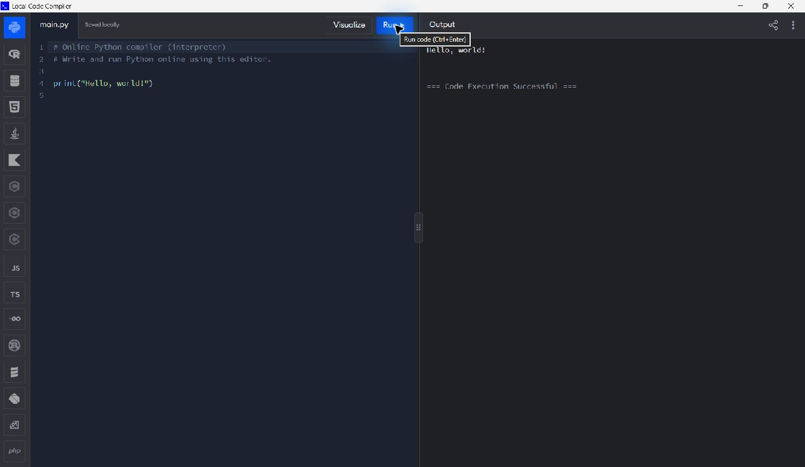

# Local Code Compiler

A local code editor and native Windows app with real Python execution, interactive input, code visualization, source-file autosaving and HTML live preview.

**[Download Windows installer](https://github.com/laxtline/My-Code-Editor/releases/latest/download/Local-Code-Compiler-Setup.exe)** · **[All downloads](https://github.com/laxtline/My-Code-Editor/releases/latest)** · **[GitHub Packages](https://github.com/laxtline/My-Code-Editor/packages)**



## Install on Windows

1. Download `Local-Code-Compiler-Setup.exe` from [Releases](https://github.com/laxtline/My-Code-Editor/releases/latest).
2. Open it, choose the installation folder, and click **Install**.
3. Start **Local Code Compiler** from the Desktop or Start Menu.

The default installation folder is `%LOCALAPPDATA%\Programs\LocalCodeCompiler`. Setup includes Python 3.14.10, the native window, frontend assets and execution workers, and adds Windows uninstall integration. No administrator access is required for the default per-user install.

Your source files are saved in the installed app's `workspace` folder. Updates preserve existing files. Uninstall retains your saved code and app data. Setup can import code from a `workspace` folder beside the installer without overwriting installed source files.

The portable `Local-Code-Compiler.exe` opens the same app without setup. Keep it in a writable folder; the first launch extracts its bundled files beside the EXE. Windows x64, Microsoft .NET Framework 4.7.2+ and Microsoft Edge WebView2 are required.

## Features

- Full-height code/output workspace without a promotional header.
- Syntax highlighting, indentation, line numbers, bracket matching, undo/redo and comments.
- Real Python execution with streaming output, `input()`, exceptions, Stop and EOF.
- Python **Visualize**: inspect up to 500 steps, variables, containers and function-call frames.
- All 18 language choices switch in the same window and restore separate saved files.
- Automatic local-file saving plus **Ctrl+S**.
- Output-only text zoom: click Output and use **Ctrl+=**, **Ctrl+-**, or **Ctrl+0**. Its size is saved separately from the editor.
- No word wrap in the editor or terminal: long lines scroll horizontally and explicit line breaks are preserved.
- HTML/CSS/JavaScript live preview in a sandboxed iframe.
- SQLite query execution and JavaScript/TypeScript execution with installed Node.js.
- Dark/light themes, adjustable text, resizable panes, ZIP download, source-file import and local code-sharing links.
- F11 full screen and clean shutdown of the app's owned backend.

Python, SQLite and HTML preview are included. JavaScript/TypeScript require Node.js. R, Java, Kotlin, C, C++, C#, Go, Rust, Scala, Dart, Ruby, PHP and Swift have local adapters: install the matching compiler/interpreter on PATH to run them. Editing, saving and downloading still work when a runtime is missing.

## Run from source

Python 3.10+ is required. There are no pip dependencies or frontend build steps; browser assets are included.

```powershell
git clone https://github.com/laxtline/My-Code-Editor.git
cd My-Code-Editor
python server.py
```

Open `http://127.0.0.1:8000`. On Windows, `start.cmd` launches the browser version and `stop.cmd` stops it. The native app uses its own loopback server on port 8123 while its window is open.

Each language saves to `workspace/`, for example `main.py`, `main.js`, `main.sql` and `index.html`. User source files, `data/`, logs and caches are excluded from Git. Shared links work on the same computer while the matching server is available.

## Downloads and packages

| File | Purpose |
| --- | --- |
| `Local-Code-Compiler-Setup.exe` | Recommended installer |
| `Local-Code-Compiler.exe` | Portable Windows app |
| `Local-Code-Compiler-Windows-x64.zip` | Both EXEs, guide and notices |
| `SHA256SUMS.txt` | Release download checksums |

GitHub Maven package: **`com.github.laxtline:local-code-compiler-windows:1.2.0`**. Its primary artifact is the setup EXE; portable EXE and ZIP attachments are included. The package workflow publishes the same verified release assets. Most users should download the installer directly from Releases.

## Build on Windows

Supply an embedded Python distribution and the WebView2 SDK DLLs:

```powershell
python build_exe.py --runtime C:\dependencies\python-embed --webview C:\dependencies\webview2
python build_installer.py
```

The WebView2 folder must contain `Microsoft.Web.WebView2.Core.dll`, `Microsoft.Web.WebView2.WinForms.dll` and x64 `WebView2Loader.dll`. The .NET Framework C# compiler builds the native EXEs. See [dependency versions and official downloads](windows/dependencies.json). The setup never embeds personal source files or databases.

To refresh public visual assets and the vendored editor, run `npm ci --prefix frontend-deps`, then `python setup_assets.py`. Normal local use does not require network access.

## Verification and limits

Run `python test_server.py` with the local server running. Nine integration checks cover Python/JS/TS/SQL execution, Unicode, input/EOF, errors, Stop/timeout/output limits, traces, local saving, sharing, ZIP downloads and request-origin checks. Set `LOCAL_COMPILER_TEST_URL` for another local port.

After building Setup, run `python test_installer.py` to verify extraction, bundled execution, source import, upgrade preservation and uninstall preservation in an isolated build folder. Native execution and close/reopen behavior were also checked.

This is a personal local tool. Programs run under your Windows account and can access local files and networks; the execution directory is not a security sandbox. The server binds to loopback and validates Host/Origin and request headers.

Limits: four simultaneous runs, 20 seconds of execution, 1 MB output and 10 minutes of waiting for Python input. SQL uses a fresh in-memory database and shows up to 1000 rows. TypeScript uses Node's native type stripping; syntax requiring transpilation needs an additional compiler.

## License and credits

Application source is [MIT licensed](LICENSE). Third-party components and visual assets retain their own rights; see [notices](THIRD_PARTY_NOTICES.md). This independent local recreation is inspired by Programiz's interface and is not affiliated with Programiz. The previous editor remains available in Git history.
